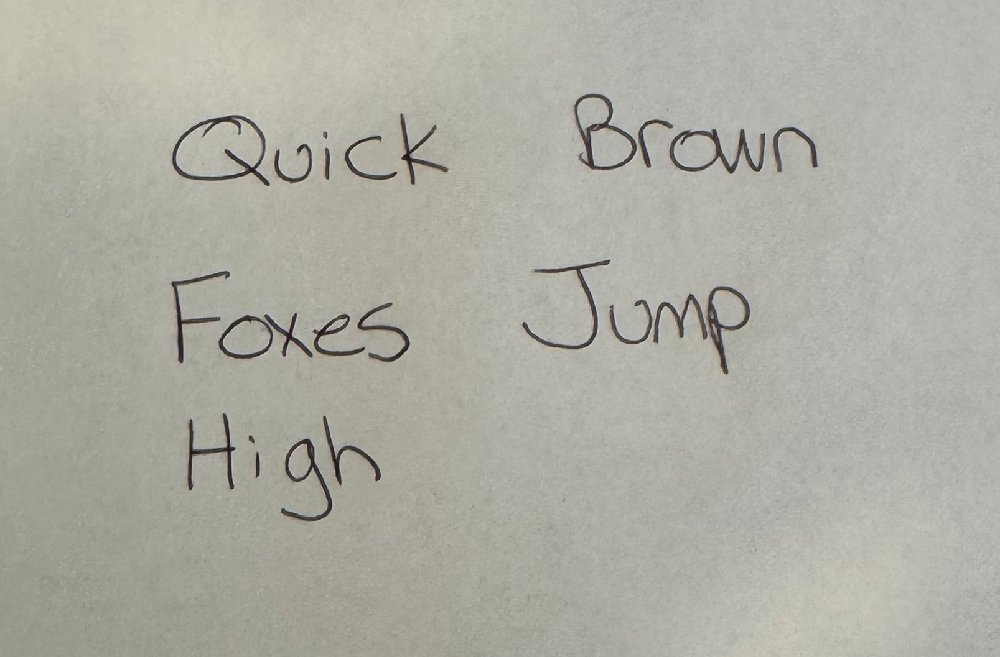
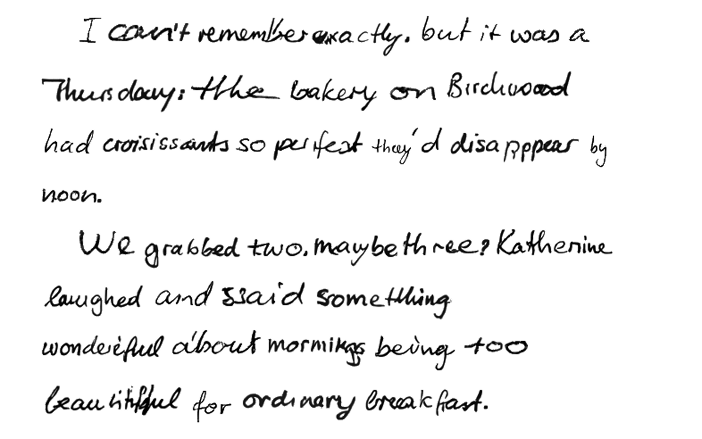

# Reforge

Reforge generates handwritten notes from text. You provide a photograph of someone's handwriting (a sentence of 5 words) and the text you want written. Reforge segments the handwriting sample into individual words, extracts the writer's style, and generates arbitrary English text in that style as a grayscale PNG. Multi-line and multi-paragraph output is supported.

The system is built on [DiffusionPen](https://github.com/koninik/DiffusionPen) (ECCV 2024), a diffusion model trained on the IAM handwriting dataset. Reforge wraps DiffusionPen in a full production pipeline: preprocessing, quality-aware generation, multi-layer postprocessing, cross-word harmonization, and page composition.

## Example

**Style input** (a photograph of 5 handwritten words) **->** **Generated output** (43 words, two paragraphs):

<p>

&nbsp;&nbsp;&rarr;&nbsp;&nbsp;

</p>

[Output history](docs/OUTPUT_HISTORY.md) tracks quality improvement over time.

```bash
python reforge.py \
    --style styles/hw-sample.png \
    --text "The morning sun cast long shadows across the quiet garden. Birds sang their familiar songs while dew drops sparkled on fresh green leaves.\nShe sat near the old stone wall, reading her favorite book. The pages felt warm and soft under her fingers." \
    --output result.png \
    --seed 42
```

`--seed` makes a run reproducible (pixel-identical across processes), and every run writes a manifest next to the image (`result.json`: seed, settings, git state, quality metrics).

### What this is not

- Not real-time. Batch generation takes ~3 seconds per word on an RTX 4000.
- Not a training system. DiffusionPen weights are frozen; reforge is inference-only.
- Not multilingual. The IAM dataset is Latin script only (80-character ASCII subset).
- Not a web app. CLI-first, library-second.

### Recent improvements (October 2026)

An audit of the pipeline and of how quality was being measured ([write-up](docs/audit-2026-10-13.md)) found that the most persistent complaint from human reviews, short words looking oversized or raised ("superscript"), came from wrapper bugs rather than model limits:

- **Size by x-height, not total height.** DiffusionPen fills its canvas for every word, so equal total heights made "was", "on" and "so" twice the body size of their neighbors. Words are now sized so their lowercase bodies match, predicted from their letters. A blind human A/B preferred it on 3 of 3 seeds.
- **Words sit on their lines.** A baseline "outlier clamp" compared row positions across differently scaled word images and moved about 30% of words up or down. Baseline detection now uses the word's text, cross-checks two estimators, and is pinned by a golden test of 81 real word crops with eye-verified baselines.
- **One resample per word.** Chained resizes had blurred short words; "by" came out as a smudge.
- **Contractions and punctuation.** Contraction halves align on their baselines; "Wait...", "don't." and "Really?!" render every mark; marks scale with the word.
- **Measurement you can trust.** The metric that gated the build had stopped tracking human ratings (correlation +0.30 on the reviews it was chosen from, -0.22 on later ones). It was replaced by a body-size consistency check validated by human A/B, runs are seeded and recorded, human reviews are versioned, and new instruments were validated against known-answer cases before use ([CV instruments](docs/cv-instruments.md)).

---

## How It Works

Reforge processes text through seven pipeline stages. Each stage applies specific CV techniques to transform raw model output into clean, readable handwritten pages.

### 1. DiffusionPen: the generative model

DiffusionPen is a latent diffusion model conditioned on both text content and handwriting style. It operates in a 64x256 pixel latent space, generating one word at a time. The model takes three inputs:

- **Text conditioning**: a character sequence tokenized by Google's Canine-C encoder, injected via cross-attention
- **Style conditioning**: visual features from 5 reference word images, injected via timestep embedding
- **Noise**: a random latent that the model iteratively denoises over 50 DDIM steps

The model has a hard architectural constraint: exactly 5 style images are required. The UNet reshapes style features with a literal `y.reshape(b, 5, -1)` followed by mean-pooling. This means the style input must always be a 5-word sentence.

Reforge adds everything around DiffusionPen: segmenting the style photograph into words, encoding them, orchestrating per-word generation, cleaning up artifacts, normalizing sizes, and composing words into pages.

### 2. Preprocessing: style image segmentation

The input photograph goes through:

1. **Adaptive thresholding** (Gaussian, 31x31 kernel) converts the grayscale photo to binary, handling uneven lighting across the page.
2. **Morphological dilation** with adaptive horizontal kernels bridges gaps between letters within words, preparing for connected-component analysis.
3. **Connected-component extraction** (8-connectivity) identifies word regions. Noise is filtered by area and minimum dimension thresholds.
4. **Reading-order sorting** clusters components into lines by Y-centroid proximity, then sorts left-to-right within each line.

Each extracted word is then individually processed:

- **Deskew** via `cv2.minAreaRect()` on ink pixels, correcting slant up to 30 degrees. White fill prevents dark border artifacts.
- **CLAHE** (Contrast-Limited Adaptive Histogram Equalization, 4x4 tiles, clip limit 2.0) normalizes contrast without over-amplification.
- **Aspect-preserving resize** to the model's input dimensions (64x256), center-padded with white.
- **DiffusionPen normalization**: `(pixel/255 - 0.5) / 0.5`, mapping white to +1 and black to -1. Not ImageNet normalization.

### 3. Style encoding

A MobileNetV2 backbone (pretrained on ImageNet, fine-tuned with triplet loss on IAM writer pairs) extracts visual style features. Each of the 5 word images produces a 1280-dimensional feature vector. These raw features are passed directly to the UNet without pooling.

The triplet-loss encoder generalizes better to unseen handwriting than the alternative class-based encoder, which is optimized for writers in the IAM training set.

### 4. Generation: DDIM sampling with quality gates

For each word in the input text:

1. **Adaptive canvas width**: 256px for words up to 8 characters, scaling linearly to 320px for 9-10 character words. Rounded to multiples of 16 for the UNet's convolutional architecture.

2. **Syllable splitting**: words longer than 10 characters are split using a scoring function that considers chunk balance, consonant-cluster boundaries, and a minimum of 4 characters per chunk (the IAM training minimum). Each chunk is generated separately and stitched.

3. **DDIM sampling with classifier-free guidance (CFG)**: two UNet passes per timestep. The conditional pass uses the real text and style features. The unconditional pass uses a space token and zero-style features. Combined as `noise = uncond + 3.0 * (cond - uncond)`.

4. **Best-of-N selection**: 3 candidates are generated per word, ranked by a quality score that evaluates background cleanliness, ink density, edge sharpness (Sobel gradients), height consistency, and contrast.

5. **OCR rejection loop**: the winning candidate is evaluated by TrOCR (a transformer model trained on handwritten text recognition). If character-level accuracy falls below 0.3, the word is regenerated, up to 2 retries. This catches cases where the diffusion model produces plausible-looking but unreadable output.

### 5. Postprocessing: five defense layers against gray-box artifacts

DiffusionPen generates dark-gray backgrounds (~150-175 brightness) around word ink, especially for short words. A single threshold cannot distinguish ink from background. Five complementary layers handle this:

**Layer 1: Adaptive background estimation.** The 90th-percentile pixel value estimates the background level. Ink is defined as pixels below 70% of this estimate, adapting to each word's particular background shade.

**Layer 2: Body-zone noise removal.** The middle 60% of rows (20%-80%) defines the "body zone" where letter bodies live. Columns without at least 5% body-zone ink are blanked. Connected-component analysis on strong ink (<128) preserves columns that belong to the same character as body-zone-valid columns, preventing clipping of crossbars ("T"), ascenders ("t", "l"), and descenders.

**Layer 3: Transitive cluster filtering.** Continuous runs of ink columns are identified using a lenient threshold (<230, catching faint inter-letter strokes). Neighboring clusters within 20px are merged transitively: if A is near B and B is near C, all three form one group. Only groups with no neighbor in the main cluster are removed. This preserves words with natural letter spacing while removing truly isolated noise.

**Layer 3b: Word-level gray cleanup.** Gray fringe pixels (160-220) not adjacent to strong ink (<128) within a 5x5 dilation radius are set to white. This removes diffusion noise halos at the word level.

**Layer 4: Compositor ink-only compositing.** During page composition, only pixels below brightness 200 are written to the canvas. Faint background pixels are not transferred.

**Layer 5: Post-upscale halo cleanup.** After 2x bicubic upscaling, interpolation creates gray halos around sharp edges. Strong ink is dilated by 4px, and gray pixels (128-230) outside this dilated region are blanked.

### 6. Sizing and harmonization

DiffusionPen fills its 64px canvas vertically for every word, whatever its letters: "was" and "remember" both arrive about 64px tall, so "was" has roughly twice the body (x-height) of "remember". Equalizing total word height keeps that gap and makes short words look shouted next to long ones.

**Zone sizing** instead sizes every word so its x-height matches. The word's letters predict how many x-heights tall its ink is (all-body "was" about 1.2, "the" about 2.3, "by" with both an ascender and a descender about 2.9). Two letters behave differently in this hand: "t" and an "i" dot rise only a little (short ascenders), and a cursive "f" descends as well as ascends; treating them as ordinary letters sized "is", "rain", "for" and "of" 20-30% small. For words of four or more letters, the prediction is blended with the x-height measured from the image, which is reliable once a word has a dense body band. All sizing decisions are composed into one scale per word and applied in a **single resample**; chaining resizes blurred short words and once reduced "by" to a smudge. In a blind A/B against equal-total-height sizing, the human reviewer preferred zone sizing on all three test seeds.

**Stroke harmonization** then converges stroke widths (partial erosion/dilation for words more than 15% off the median) and shifts each word's ink toward the global median brightness with a blend factor of 0.92.

### 7. Composition: page layout

Words are arranged on a page with:

- **Baseline detection** uses the word's text. Trailing punctuation is set aside first (a comma's tail once lifted "it," onto its t crossbar). A word with no descender-capable letter (g, j, p, q, y, cursive f) sits on its ink bottom. For descender words, two estimators run: a density scan down from the word's midpoint, and the bottom of the dense body band. They fail in opposite directions (the scan can land in a descender that dominates a short word like "gym" or "up"; the band can sit a little high on a thin round bottom like the "o" of "for"), so the scan is kept when they agree and the band wins when they do not. 81 real word crops with eye-verified baselines pin this behavior in a golden test.
- **Line wrapping**: words are placed left-to-right until they exceed the page width (800px minus 30px margins), then wrap to a new line with 12px spacing.
- **Paragraph layout**: None sentinels in the word list trigger paragraph breaks with 30px spacing and 40px indent.
- **Baseline-aligned compositing**: each word's detected baseline is placed on its line's ruled baseline. There is no outlier snapping: word images are scaled by different factors, so their baseline rows are not comparable, and an earlier snap-to-median clamp misplaced about 30% of words.
- **2x upscaling** with bicubic interpolation for the final output, followed by Layer 5 halo cleanup.

---

## Testing and the Agentic Coding Loop

Reforge is developed using an experiment-driven workflow where Claude Code iterates on output quality, measuring each change and deciding whether to keep or revert it.

### Metrics, and their limits

Quality dimensions are reduced to numbers the agent can compare across runs:

| Metric | What it measures | Status |
|--------|-----------------|--------|
| `check_x_height_consistency()` | Body size of short all-body words vs. long words, measured from pixels with sub-pixel precision | Gates the build; matches a blind human A/B |
| `check_gray_boxes()` | Rectangular gray artifacts | Hard gate inside `overall` |
| `check_ink_contrast()` | Ink-to-background separation | Hard gate inside `overall` |
| `check_background_cleanliness()` | Isolated noise in background | Hard gate inside `overall` |
| `check_stroke_weight_consistency()` | Cross-word ink uniformity | Diagnostic |
| `check_word_height_ratio()` | Max/min total word height | Diagnostic (rewards the old equal-height policy) |
| `check_baseline_consistency()` | Offset of each placed word's ink baseline from its line | Diagnostic; clean pages ~0.92, injected baseline jitter ~0.64 |
| `check_word_gap_ratio()` | Median gap between words, in x-heights | Diagnostic measurement |
| `check_baseline_alignment()` | Spread of word-canvas bottoms | Retired in practice: does not look at ink |
| OCR (`ocr_accuracy`, `ocr_min`) | TrOCR character accuracy vs. target text | Floor gate on 3+ letter words |

`overall_quality_score()` combines the continuous metrics with weights, caps the result when a hard gate fails, multiplies by the fraction of readable words (OCR >= 0.5), and caps at 0.45 when words are mostly blank.

The metrics are instruments, not the goal. Spearman correlation against 34 human composition ratings (`docs/metric_correlation.md`) shows no CV metric that reliably tracks overall human preference: the metric originally chosen to gate the build correlated at +0.30 on the reviews it was selected on and -0.22 on the 18 reviews collected since. The workflow therefore leans on controlled human comparisons:

- **Seeded runs.** `--seed` makes output pixel-identical across processes, and every run writes a manifest (`result.json`) with the seed, settings, git state and metrics.
- **Generation held fixed.** For changes downstream of the model, generated words are cached once and both variants are rendered from the cache, so only the change under test differs.
- **Blind pairwise review.** A human picks between randomized A/B pages instead of rating single pages 1-5. A fresh-context Claude judge with a fixed rubric reviews the same pairs first: it has agreed with the human on 6 of 6 pairs and picked the clean page on 12 of 12 known-answer pairs with injected defects (blur, oversized words, baseline jitter, cramped spacing).
- **Instruments are validated before use.** A judge or metric must pass known-answer cases first ([CV instruments](docs/cv-instruments.md)). Two findings from doing that: local vision-language models that fit a 20 GB GPU read words better than TrOCR but are not trustworthy page judges (they flip their answer when the A/B order flips), and a better reader made a worse candidate selector, because it reads split and overinked candidates as the right word and stops filtering them.
- **Looking at the output.** Claude Code reads the PNGs directly; contact sheets of every word with detected baselines drawn found more bugs than any metric.

### Three test tiers

| Tier | Runtime | GPU | What it validates |
|------|---------|-----|-------------------|
| **Quick** (~330 tests) | ~5s | No | All metric functions, sizing, scoring logic, layout and baseline placement, preprocessing, punctuation routing, gate logic. Everything mocked. Runs on every commit (pre-commit hook). |
| **Medium** (~40 tests) | ~4 min | Yes | Real model generation: the regression gate (runs before every push), A/B comparisons, OCR, hard words, contraction sizing. |
| **Full** (e2e) | ~10 min | Yes | Complete pipeline with real style images. Visual output saved to `tests/full/output/` for inspection. |

```bash
make test-quick     # quick tests only
make test           # medium tests (default)
make test-full      # full e2e tests
make setup-hooks    # pre-commit: quick tests; pre-push: regression gate
```

### The feedback loop

```
  Make a change (adjust threshold, modify postprocessing, tune parameter)
       |
       v
  Run tests/medium/ --> numeric metrics for every quality dimension
       |
       +---> All pass?  --> Commit, move to next task
       |
       +---> Failure?   --> Which metric failed? By how much?
                |
                v
          Run diagnostic instrument
                |
                v
          Identifies which pipeline stage caused the regression
          (e.g., "Layer 3 removed 47 columns from right 25%")
                |
                v
          Adjust that specific stage, re-run tests
```

### Key instruments

**Quality regression test** (`test_quality_regression.py`). Generates the five style words plus short words of each letter class (`was so on by it`) across 3 fixed seeds (42, 137, 2718), runs them through the same sizing and composition stages as production, and compares against a recorded per-seed baseline in `quality_baseline.json`. The gating metric (`x_height_consistency`) must not drop by more than 0.05 on any seed, every word of three or more letters must read at OCR >= 0.3, and the composed image must match a reference at SSIM >= 0.80. A baseline recorded for a different word list, or missing a gating metric, fails the test. Baseline updates are deliberate and manual: `pytest tests/medium/test_quality_regression.py --update-baseline --update-reference -x -s`.

**OCR rejection loop** (inside `generate_word()`). During generation, each word's best candidate is evaluated by TrOCR. If character accuracy is below 0.4, the word is regenerated up to 2 times. This is a generation-time quality gate: the agent's postprocessing changes can affect what passes this gate, creating a direct feedback signal.

**Postprocessing diagnostic** (`diagnose_postprocessing()`). Traces a word image through each defense layer, reporting:
- Ink extent near left/right edges before and after each layer
- Number of ink columns removed from each edge region
- OCR accuracy before vs. after each layer

This pinpoints the exact layer responsible for any character clipping. The diagnostic was used to identify that Layer 3 (isolated cluster filter) was responsible for 8 out of 12 words losing characters in an earlier version, leading to the transitive-merge fix.

**Per-word quality scoring** (`quality_score()`). Used during best-of-N candidate selection. Evaluates Sobel edge gradients, ink density, contrast, background cleanliness, and height consistency. The winning candidate feeds into the OCR rejection loop, creating a two-stage quality funnel: aesthetic quality first, then readability.

### A/B experiments

The A/B harness (`experiments/ab_harness.py`) runs structured comparisons between parameter variants:

```bash
python experiments/ab_harness.py --style styles/hw-sample.png --experiment cfg
```

Predefined experiments vary CFG scale (1.0 vs 3.0 vs 5.0 vs 7.5) and step counts. (The scheduler and postprocessing presets are defined but the harness does not apply those keys yet, so those variants currently run identical configurations.) For each variant, the harness:

1. Generates N candidates per word across multiple runs
2. Computes `overall_quality_score()` on each
3. Tracks mean and standard deviation across runs
4. Generates a labeled comparison PNG showing each variant's best output alongside its metrics
5. Accumulates results in `experiments/output/results.json`

The comparison images and metrics JSON give the agent two channels of feedback: numeric scores for pass/fail decisions, and visual comparisons for understanding why one variant wins.

For changes downstream of the model (sizing, composition, post-processing), `experiments/replay_cache.py` caches seeded generations once and renders them with the working tree or any git ref, so both arms of an A/B use identical words. `experiments/cv_bench/` holds the instrument benchmarks: 213 labeled word crops for comparing readers, and a builder for known-answer page pairs for validating judges. `scripts/vlm_server.sh` serves the optional local vision-language model.

### Where the agent "inspects" images

Claude Code is multimodal. It can read PNG files directly, viewing the actual generated handwriting. The system exploits this at several points:

- **result.png** after demo.sh: the agent reads the final output image to spot issues that metrics miss (e.g., "words look like white blocks are occluding them", which led to the word-clipping diagnostic and fix).
- **A/B comparison PNGs**: side-by-side variant images with labels and metrics overlaid. The agent sees which variant looks better and confirms the numeric ranking.
- **Diagnostic tracing**: the `diagnose_postprocessing()` function reports numeric deltas, but the agent can also read intermediate images at each layer to understand what's being removed.
- **test/full/output/**: e2e test outputs saved as PNGs. The agent reads these to validate that composed pages look correct beyond what metrics capture.
- **Contact sheets**: every word of a page cropped side by side, with detected baselines and the target x-height drawn on. These found more defects than any metric (the baseline clamp, the resize bottleneck, short descender words detected at their tails).

This dual-channel approach (numeric metrics for automated decisions, visual inspection for novel failure modes) is what makes the agentic loop effective. Metrics handle the 90% case. When a human looks at the output and says "words are being clipped", the agent builds a diagnostic instrument, finds the root cause numerically, fixes it, and adds a test so the same failure class is caught automatically going forward.
